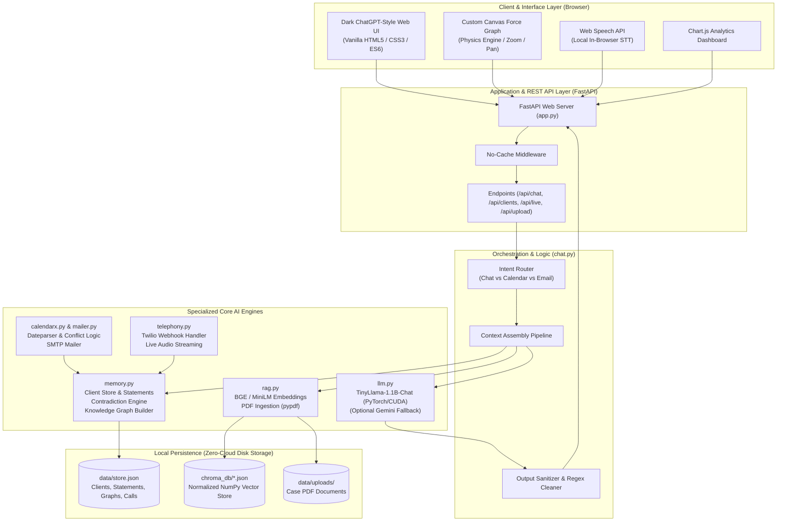

# ⚖️ Lexora — Offline-First AI Legal Assistant

<p align="center">
  
</p>

<p align="center">
  <strong>An entirely on-device, privacy-preserving AI assistant engineered for practicing lawyers and legal professionals.</strong><br>
  <em>100% offline LLM inference, persistent semantic memory, dynamic knowledge graphs, and offline document intelligence — with zero cloud data leaks.</em>
</p>

<p align="center">
  
  
  
  
  
  
  
</p>

---

## 📌 Table of Contents

- [Overview & The Problem](#-overview--the-problem)
- [Key Features](#-key-features)
- [System Architecture](#-system-architecture)
- [Tech Stack](#-tech-stack)
- [Repository Structure](#-repository-structure)
- [Installation & Quick Start](#-installation--quick-start)
- [Configuration (.env)](#-configuration-env)
- [Interactive Demo Walkthroughs](#-interactive-demo-walkthroughs)
- [API Reference](#-api-reference)
- [Privacy, Ethics & Security](#-privacy-ethics--security)
- [Project Credits & Acknowledgements](#-project-credits--acknowledgements)

---

## 🧠 Overview & The Problem

Modern legal practice is heavily reliant on meticulous documentation, nuanced client testimony, and strict adherence to deadlines. While generative AI tools like ChatGPT have revolutionized general workflows, they present an unacceptable risk for the legal sector:

1. **Breach of Attorney-Client Privilege:** Commercial cloud-based AI providers inspect, store, or train upon ingested prompt data. Transmitting privileged case files to third-party cloud servers violates confidentiality and ethical mandates.
2. **Fragmented Case Memory:** Client disclosures, timeline dates, and case facts scatter across emails, transcripts, and notebooks. Lawyers lack a consolidated memory engine that semantically remembers every testimony given across months of interactions.
3. **Undetected Testimony Contradictions:** Clients frequently misremember or change statements over time (*e.g., claiming to be in Bengaluru on 12 Oct, while official records place them in Mumbai*). Catching these discrepancies manually across voluminous records is difficult and error-prone.
4. **Administrative Overhead:** Legal practitioners spend excessive non-billable hours summarizing telephone consultations, extracting action items, drafting client update emails, and coordinating court hearing calendars.

### The Lexora Solution
**Lexora** is a completely self-contained, air-gapped legal intelligence platform. Every core computational layer — language generation, embedding extraction, vector similarity indexing, and relational knowledge graph construction — executes strictly on local hardware (CPU/GPU). Data is persisted as human-readable JSON files on the local disk. No audio, no text, and no documents ever leave the machine.

---

## ✨ Key Features

### 1. 💬 Offline Legal Chat (ChatGPT-Style)
- **Local Model Execution:** Powered by `TinyLlama-1.1B-Chat` through HuggingFace Transformers and PyTorch (runs in FP16 on CUDA GPUs or CPU).
- **Context-Augmented Assembly:** Chat turns are dynamically built by concatenating relevant memory statements, retrieved document passages (RAG), conversation history, and real-time conflict warnings.
- **Output Hygiene Filter:** In-line regex processors sanitize model outputs, stripping context-echoing and hallucinated links common in small-parameter models.

### 2. 🧠 Persistent Per-Client Factual Memory
- Remembers every testimony, claim, and factual statement made by or regarding a client.
- Vectorized using `sentence-transformers` (`all-MiniLM-L6-v2` or `BGE-small-en-v1.5`) and indexed in a normalized cosine vector space.
- Complete thread-safe JSON persistence (`data/store.json` and `chroma_db/*.json`) protected with re-entrant locks (`RLock`); data persists across app restarts.

### 3. 🕸️ Interactive Force-Directed Knowledge Graph
- **Autonomous Entity & Relation Extraction:** Analyzes factual entries and structures them into entities (*Person, Organization, Place, Object, Event*) and relationship edges via structured LLM extraction.
- **Cross-Case Unified Entities:** Case-insensitive entity reconciliation automatically connects distinct cases sharing the same counterparty (*e.g., a fraudulent supplier appearing across multiple commercial lawsuits*).
- **Custom HTML5 Canvas Renderer:** Smooth, zero-dependency browser canvas featuring physics-based repulsion/attraction, pan, zoom, entity search, node filtering, and details inspection (no heavy D3/Three.js dependencies).

### 4. 📄 Air-Gapped PDF Document Intelligence (Offline RAG)
- Ingests legal documents, affidavits, contracts, and case judgments using `pypdf`.
- Splits content into overlapping token windows and indexes chunks into a local NumPy cosine index with metadata binding them to the client matter.
- Chat inquiries retrieve relevant case text with transparent document and chunk source citations.

### 5. ⚠️ Deterministic Contradiction Detection Engine
- Operates independently of small-model unreliability using a dual-phase semantic + heuristic engine:
  - **Polarity / Negation Inversion:** Flags identical subjects where one claim asserts and another denies (*e.g., "was present at the warehouse" vs. "was not at the warehouse"*).
  - **Chronological & Numerical Conflicts:** Detects conflicting times, dates, or numerical discrepancies for the same event (*e.g., meeting at 5:00 PM vs. 9:00 PM*).
- Renders an unmistakable high-visibility contradiction alert card directly inside the chat interface.

### 6. 📞 AI Call Assistant & Telephony Bridge
- **In-Browser Live Speech-to-Text:** Uses the native Web Speech API (`SpeechRecognition`) for local, zero-cloud transcription of face-to-face meetings or speakerphone calls.
- **Twilio Dual-Phone Remote Bridge:** Connects real inbound and outbound phone calls between lawyer and client over Twilio with live streaming transcription pumped into local memory via webhooks.
- **Automated Client Onboarding:** Detects caller names and case types from spoken opening statements (*e.g., "My name is Rohit, I had a vehicle theft"*), automatically creating and configuring client records.
- **Automated Meeting Summaries & Action Items:** Generates structured post-call debriefs, follow-ups, and action items upon hanging up.

### 7. 📅 Natural Language Calendar & Clash Detection
- Understands natural scheduling expressions (*"Schedule a court hearing tomorrow at 3pm"*).
- Cross-references existing schedules and warns the lawyer if a scheduling clash exists.
- Automatically stores the hearing into client memory, adds it to the knowledge graph, and outputs a one-click **Add to Google Calendar** link.

### 8. 📧 Automated Client Case Mailer
- Instant intent recognition (*"Send an email to my client with his case details"*).
- Synthesizes case facts, upcoming hearings, and current status into a professional email dispatched directly via Gmail SMTP (using secure Google App Passwords).

### 9. 📊 Case Insights & Analytics Dashboard
- Visualizes caseload status breakdown (*Solved, In-Progress, Open, Unsolved*).
- Displays case categories (Criminal, Property, Divorce, Commercial, Fraud) via embedded **Chart.js**.
- Maintains an immutable activity log auditing client creation, graph merges, contradictions, calls, and file uploads.

---

## 🏛️ System Architecture



---

## 🛠 Tech Stack

| Domain | Technology / Library | Purpose & Implementation |
|---|---|---|
| **Runtime & Language** | **Python 3.11** | Core backend environment with CUDA/GPU acceleration |
| **API Framework** | **FastAPI + Uvicorn** | Asynchronous REST endpoints, no-cache middleware, static asset delivery |
| **Data Validation** | **Pydantic v2** | Strict schema validation for all API inputs and outputs |
| **Local LLM** | **TinyLlama-1.1B-Chat** | Local on-device text generation via `transformers` and `torch` (FP16) |
| **Fallback LLM** | **Google Gemini (google-generativeai)** | Optional, silent remote fallback (never surfaced in UI) |
| **Embeddings** | **all-MiniLM-L6-v2** / **BGE-small** | 384-dimensional dense semantic vectors via `sentence-transformers` |
| **Vector Index** | **Custom NumPy Cosine Index** | High-performance, portable vector store persisted to JSON |
| **PDF Extraction** | **pypdf** | In-memory text extraction, cleaning, and chunking |
| **Graph Modeling** | **Custom Graph Model + NetworkX** | Dynamic node/edge schema serialized directly to local JSON |
| **Frontend UI** | **Vanilla HTML5, CSS3, JavaScript** | Modern, dark-mode ChatGPT-style UI without heavy web frameworks |
| **Data Visualization** | **Chart.js (vendored)** | Offline caseload distribution and metrics charts |
| **Graph Visualization**| **Custom Canvas Force Simulator** | Canvas 2D engine with spring attraction and node repulsion |
| **Speech-to-Text** | **Web Speech API** | Browser-native live transcription (Chrome & Edge) |
| **Telephony** | **Twilio Voice & TwiML** | Remote two-phone call bridging with real-time transcription webhooks |
| **Email Protocol** | **Python `smtplib` + SSL** | Secure SMTP case dispatch via Gmail App Passwords |
| **Natural Dates** | **dateparser** | Semantic date and relative time extraction from conversational text |

> **💡 Architectural Note — Custom NumPy Vector Store vs. ChromaDB:**  
> Standard local ChromaDB binary builds occasionally trigger native SQLite compaction locks (`mismatched types u64/BLOB`) on fresh standalone environments. Lexora implements a zero-failure **NumPy Cosine Index** where unit-normalized vectors allow cosine similarity via dot product (`np.dot`). It is fast, mathematically identical, and persists cleanly to human-readable JSON files.

---

## 📂 Repository Structure

```
Lexora/
├── app.py                     # FastAPI web server, routes, upload handlers, and Twilio webhooks
├── chat.py                    # Orchestrator: context assembly, intent routing, and reply formatting
├── llm.py                     # TinyLlama-1.1B loader, generation loop, JSON extraction, fallback
├── memory.py                  # Client management, statements, contradiction engine, and graph store
├── rag.py                     # Sentence-transformers embedder, NumPy vector store, and PDF parser
├── calendarx.py               # Natural language date parsing, timetable conflict detection, Google links
├── mailer.py                  # Gmail SMTP client for dispatching case summaries
├── telephony.py               # Twilio call session manager and transcription stream parser
├── seed_data.py               # Synthetic legal cases generator and zero-dependency PDF builder
├── config.py                  # Central configuration loader (.env loader and filesystem paths)
├── requirements.txt           # Python package dependencies
├── .env.example               # Template for optional keys (Gemini, Gmail, Twilio)
├── techstack.md               # Detailed architectural and engineering notes
├── GMAIL_CALENDAR_SETUP.md    # Guide for Gmail App Passwords and Google Calendar
├── TWILIO_SETUP.md            # Guide for Twilio two-phone live call bridging with ngrok
├── static/                    # Frontend client assets
│   ├── index.html             # Application markup (Chat, Graph, Docs, Calls, Dashboard)
│   ├── styles.css             # Polished dark theme styling
│   ├── app.js                 # Frontend application controller and Canvas graph engine
│   └── vendor/                # Vendored offline JS libraries
│       ├── chart.umd.min.js   # Offline Chart.js
│       └── vis-network.min.js # Network visualization utilities
├── data/                      # Local data directory (auto-created)
│   ├── store.json             # Clients, statements, knowledge graph, and calls
│   └── uploads/               # Uploaded PDF case documents
└── chroma_db/                 # Local vector database storage
    ├── documents.json         # Embedded PDF chunk vectors
    └── memory.json            # Embedded statement memory vectors
```

---

## 🚀 Installation & Quick Start

### 1. Prerequisites
- **Operating System:** Windows 10/11, macOS, or Linux.
- **Python Version:** **Python 3.11** recommended.
- **Hardware:**
  - *GPU (Recommended):* NVIDIA GPU with CUDA support for near-instant inference.
  - *CPU:* Supported out of the box (runs in FP32).

### 2. Clone the Repository
```bash
git clone https://github.com/Saaduddin47/Lexora-.git
cd Lexora-
```

### 3. Create a Virtual Environment
```bash
# On Windows
python -m venv venv
.\venv\Scripts\activate

# On Linux / macOS
python3 -m venv venv
source venv/bin/activate
```

### 4. Install Dependencies
```bash
pip install --upgrade pip
pip install -r requirements.txt
```

> **Note on PyTorch with CUDA:** If you have an NVIDIA GPU, install PyTorch with CUDA enabled:
> ```bash
> pip install torch torchvision torchaudio --index-url https://download.pytorch.org/whl/cu121
> ```

### 5. Configure the Model
By default, Lexora can load `TinyLlama/TinyLlama-1.1B-Chat-v1.0` directly from HuggingFace, or you can specify the absolute path to your pre-downloaded model folder in `.env` or `config.py`:
```env
MODEL_NAME=TinyLlama/TinyLlama-1.1B-Chat-v1.0
EMBED_MODEL_NAME=all-MiniLM-L6-v2
```

### 6. (Optional) Seed Demo Data
Populate the application with realistic legal matters (custody disputes, property claims, contract breaches, and corporate disputes):
```bash
python seed_data.py --reset
```

### 7. Run the Application Server
```bash
python app.py
```
*The server will start on `http://localhost:1000` (or `http://127.0.0.1:1000`).*

Open the URL in **Google Chrome** or **Microsoft Edge** (for full Web Speech API compatibility).

---

## ⚙️ Configuration (.env)

Create a `.env` file in the project root by copying the template:
```bash
cp .env.example .env
```

| Variable | Default | Description |
|---|---|---|
| `LLM_BACKEND` | `auto` | `auto` (local primary, fallback if error), `local` (strict offline), or `gemini` |
| `MODEL_NAME` | *(Local Path)* | HuggingFace model repo name or local folder containing model weights |
| `EMBED_MODEL_NAME` | `all-MiniLM-L6-v2` | Sentence-transformer model for semantic embeddings |
| `CHROMA_DB_PATH` | `./chroma_db` | Folder where vector JSON databases are stored |
| `GEMINI_API_KEY` | *(empty)* | Optional fallback API key for Google Gemini |
| `GMAIL_ADDRESS` | *(empty)* | Gmail account for sending client case briefs |
| `GMAIL_APP_PASSWORD`| *(empty)* | 16-character Google App Password (2-Step Verification) |
| `DEFAULT_CLIENT_EMAIL`| *(empty)* | Default recipient email used during demonstrations |
| `TWILIO_NUMBER` | *(empty)* | Twilio phone number in E.164 format (*e.g., +1XXXXXXXXXX*) |
| `TWILIO_CLIENT_NUMBER`| *(empty)* | Target client phone number to dial |
| `PUBLIC_URL` | *(empty)* | Public ngrok forwarding HTTPS URL (*e.g., https://xyz.ngrok-free.app*) |

---

## 🎭 Interactive Demo Walkthroughs

Try these scenarios to test the full range of Lexora's capabilities:

### Scenario 1: Multijurisdictional Child Custody & Contradiction Detection
1. Select or create client **Aisha Kapoor** (Family Law).
2. Type:
   ```text
   Aisha: My daughter was with me in Bengaluru on 12 Oct at 14:00.
   ```
3. Follow up with:
   ```text
   Later: I received a school attendance record showing she was in Mumbai on 12 Oct.
   ```
4. **Result:**  
   - Lexora immediately triggers a **red Contradiction Warning Card** indicating conflicting locations on the same date.
   - The knowledge graph links Aisha's daughter to both `Bengaluru` and `Mumbai`.
   - The assistant addresses the discrepancy in the opening sentence of its response.

---

### Scenario 2: Cross-Case Corporate Liability
1. Create Client A: **Nikhil Rao** (Commercial Dispute). Type:
   ```text
   TechSupplies Pvt Ltd delivered defective power units on 01 Mar; invoice unpaid.
   ```
2. Create Client B: **Sara Menon** (Product Liability). Type:
   ```text
   TechSupplies supplied the battery that overheated on 05 Apr; they refused replacement.
   ```
3. **Result:**  
   - Switch to the **Knowledge Graph** tab.
   - Notice that both distinct client records link to a shared node: `TechSupplies Pvt Ltd`.
   - The system reveals a pattern of repeat supplier liability across independent cases.

---

### Scenario 3: Real-Time Calendar Clash Detection
1. In the **General Workspace**, type:
   ```text
   Schedule a court hearing today at 5pm
   ```
   *Lexora registers the hearing and provides an "Add to Google Calendar" link.*
2. Now type:
   ```text
   I have a client consultation today at 5pm
   ```
3. **Result:**  
   - Lexora warns: *"⚠ Heads up — you already have 'Court hearing' at 5:00 PM, which clashes with this."*
   - Prevents double-booking while preserving past court dates in the event log.

---

### Scenario 4: Automated Case Summary Email
1. Open an existing client (*e.g., Ravi Kumar*).
2. Type:
   ```text
   Send an email to my client with his case details
   ```
3. **Result:**  
   - Lexora synthesizes key facts, upcoming hearing dates, and case status into an email.
   - Dispatches the email via Gmail SMTP and confirms in chat:  
     `📧 Sent Ravi Kumar a case-summary email to ravi@example.com`.

---

## 📡 API Reference

Lexora provides a REST API accessible via FastAPI:

| Method | Endpoint | Description |
|---|---|---|
| `GET` | `/api/health` | Returns server status and LLM loading state (`cpu`, `cuda`, or `offline`) |
| `POST` | `/api/chat` | Send a chat message with automatic memory recall and contradiction check |
| `GET` | `/api/clients` | Retrieve all registered clients and case metadata |
| `POST` | `/api/clients` | Create a new client profile |
| `PATCH` | `/api/clients/{id}` | Update client details (case type, status, summary, email) |
| `DELETE`| `/api/clients/{id}` | Purge client, statements, knowledge graph, and vector embeddings |
| `GET` | `/api/clients/{id}/graph` | Fetch graph nodes and edges for dynamic rendering |
| `GET` | `/api/clients/{id}/statements` | Retrieve historical testimony statements for a client |
| `POST` | `/api/upload` | Upload and chunk PDF files into the local RAG vector store |
| `GET` | `/api/documents` | List all ingested PDF documents and chunk counts |
| `POST` | `/api/live` | Process real-time transcription chunks during live calls |
| `POST` | `/api/call` | Ingest full call transcripts and generate meeting summaries + action items |
| `GET` | `/api/dashboard` | Fetch aggregated caseload analytics and activity audit log |
| `POST` | `/voice` | Twilio inbound webhook returning TwiML instructions |
| `POST` | `/transcription` | Twilio real-time transcription streaming endpoint |

---

## 🔒 Privacy, Ethics & Security

- **Zero Cloud Egress:** Client data, chat messages, and legal documents are never sent over the internet or used to train public models.
- **Compliance with Attorney-Client Privilege:** Complies with strict legal ethics and data sovereignty standards by keeping all computing processes on the lawyer's physical workstation.
- **Transparent JSON Storage:** All databases are stored as standard JSON (`data/store.json`, `chroma_db/*.json`), making data export, auditing, and backup straightforward.
- **Local Speech Processing:** Real-time speech recognition runs directly inside the browser using standard browser speech engines without external API calls.

---

## 👥 Project Credits & Acknowledgements

- **Lead Developer & Research Author:** **Taabish Ahmed Ansari**
- **Institution:** Department of Computer Science & Engineering, Faculty of Science & Technology, **IFHE University (IcfaiTech)**
- **Supervision & Mentorship:** Faculty Supervisors & Mentors at IcfaiTech
- **Open-Source Foundations:**
  - [Hugging Face Transformers](https://github.com/huggingface/transformers) & [TinyLlama](https://github.com/jzhang38/TinyLlama)
  - [Sentence-Transformers](https://www.sbert.net/)
  - [FastAPI](https://fastapi.tiangolo.com/) & [Uvicorn](https://www.uvicorn.org/)
  - [Chart.js](https://www.chartjs.org/)

---

<p align="center">
  <em>Developed with pride for secure, offline, and trustworthy legal computing.</em>
</p>
